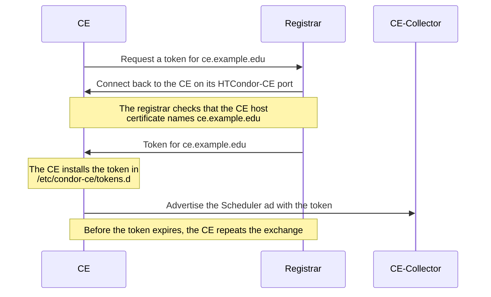
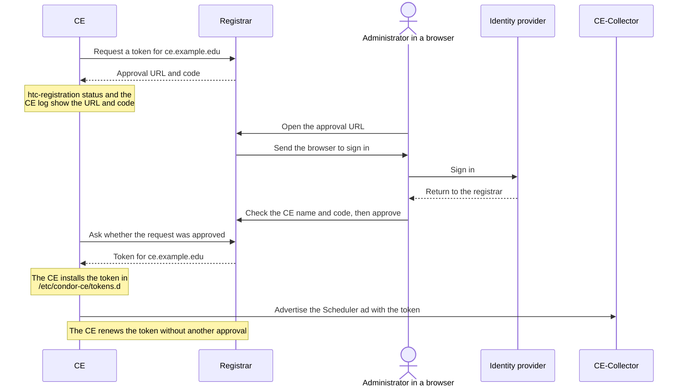

# htc-registrationd

htc-registrationd keeps an HTCondor-CE advertising to its central
CE-Collector when its host certificate can no longer be used as a client
certificate. Let's Encrypt certificates are no longer issued for client use,
so a CE that advertised with its host certificate stops being accepted when
that certificate is renewed. With htc-registrationd, the CE gets a
short-lived IDTOKEN that allows only advertising its Scheduler ad under its
own name, and renews the token before it expires.

The same program runs on each CE and beside the CE-Collector, where it is
called the registrar. A CE proves its name in one of two ways:

- **Callback mode.** The CE has a host certificate that names it. The
  registrar connects back to the CE and checks that certificate. Nobody has
  to approve anything.
- **Approval mode.** The CE-Collector cannot connect back to the CE: it is
  behind a firewall or NAT, has no public DNS name, or has no certificate
  that names it. The CE shows a
  URL and a code, and an administrator approves the request in the
  registrar's web page after signing in. Who may approve which CE comes from
  a map file or from OSG Topology. After the first approval, the CE renews
  its token without anyone's help.

### Callback mode



### Approval mode



## Install

Each release on [GitHub Releases](https://github.com/bbockelm/htc-registrationd/releases)
has an RPM for x86_64 and for aarch64, and a `SHA256SUMS` file. Install the
same package on the CEs and on the CE-Collector host:

```
VERSION=0.1.0     # the release to install
ARCH=$(uname -m)  # x86_64 or aarch64
dnf install https://github.com/bbockelm/htc-registrationd/releases/download/v${VERSION}/htc-registrationd-${VERSION}-1.${ARCH}.rpm
```

To check the download first:

```
URL=https://github.com/bbockelm/htc-registrationd/releases/download/v${VERSION}
curl -LO ${URL}/htc-registrationd-${VERSION}-1.${ARCH}.rpm
curl -LO ${URL}/SHA256SUMS
sha256sum --check --ignore-missing SHA256SUMS
dnf install ./htc-registrationd-${VERSION}-1.${ARCH}.rpm
```

The RPM requires HTCondor (the `condor` package). It installs:

| Path | What it is |
|---|---|
| `/usr/sbin/htc-registrationd` | the daemon |
| `/usr/bin/htc-registration` | the command-line tool (a link to the daemon) |
| `/etc/condor-ce/config.d/50-htc-registrationd-ce.conf` | configuration for a CE |
| `/etc/condor-ce/config.d/50-htc-registrationd-registrar.conf` | configuration for the CE-Collector |
| `/usr/share/doc/htc-registrationd/` | this README and [protocol.md](docs/protocol.md) |

Installing or upgrading the RPM starts nothing. Every line that starts the
daemon is commented out in both configuration files; you enable it in one of
them. Both files are `%config(noreplace)`, so your edits survive an
upgrade.

## Configure a CE

Before you start:

- The CE already advertises to the CE-Collector: `CONDOR_VIEW_HOST` names
  it, for example `collector.example.org:9619`. The CE finds the registrar
  there.
- The registrar is running on that CE-Collector, and its administrator has
  authorized your CE's name (see [Configure the CE-Collector](#configure-the-ce-collector)).

In `/etc/condor-ce/config.d/50-htc-registrationd-ce.conf`, uncomment the
two lines under `enable`:

```
DAEMON_LIST            = $(DAEMON_LIST) HTC_REGISTRATIOND
HTC_REGISTRATIOND_MODE = ce
```

The rest of that file is already set: it makes the daemon a DaemonCore
daemon under the master (`DC_DAEMON_LIST`, `HTC_REGISTRATIOND_ARGS = -sock htc_registrationd`),
sets its log, and adds its state directory to `VALID_SPOOL_FILES` so that
`condor_preen` keeps it.

By default (`HTC_REGISTRATIOND_METHOD = auto`), the CE uses callback mode
when it has an SSL server certificate, and approval mode otherwise or when
the callback fails. To choose one mode, add one of the settings below to a
file of your own, such as `/etc/condor-ce/config.d/60-htc-registrationd.conf`.

### A CE with a host certificate (callback mode)

```
HTC_REGISTRATIOND_METHOD = callback
```

For callback mode:

- The certificate in `AUTH_SSL_SERVER_CERTFILE` (HTCondor-CE's default
  includes `/etc/grid-security/hostcert.pem`) must name the CE, and be issued
  by a CA the registrar trusts. Let's Encrypt certificates work.
- The CE-Collector host must be able to connect to the CE's HTCondor-CE port
  (9619), which is open on a CE that accepts jobs from outside.
- The CE's address must be public: the registrar does not connect to
  private, loopback or link-local addresses unless its administrator allows
  them.

### A CE the CE-Collector cannot reach (approval mode)

```
HTC_REGISTRATIOND_METHOD = approval
```

Use approval mode when the CE is behind a firewall or NAT, has no public DNS
name, or has no certificate that names it. The CE needs only to reach the
CE-Collector on port 9619, as it already does to advertise.

The CE is registered under the name its schedd advertises (see below). On a
CE without a public DNS name, check that this name is the one the approver
expects and is allowed to approve.

### Start it

```
systemctl restart condor-ce
htc-registration status
```

In callback mode, `State` becomes `registered` within a minute. In approval
mode, `State` is `approval-pending`, and `htc-registration status` shows an
approval URL and a code; the URL is also in the daemon's log
(`/var/log/condor-ce/HtcRegistrationdLog`) and in
`/var/lib/condor-ce/spool/htc-registrationd/approval-url`. Send the URL to
an administrator of the registrar, or open it yourself if you are allowed to
approve this CE. The code expires after 30 minutes; the CE then starts a new
request with a new code.

Once the token is installed (in `/etc/condor-ce/tokens.d`, owned by root
with mode 0600, as HTCondor requires), the daemon reconfigures the CE and
checks the token against `CONDOR_VIEW_HOST`. `htc-registration status` shows the result
as `View host check`.

The CE's name is the name its schedd advertises: `SCHEDD_NAME` if set, else
the host's full name. The token is issued for that name, and the
CE-Collector accepts a Scheduler ad only when its `Name` matches.

## Configure the CE-Collector

The registrar runs under the CE-Collector's `condor_ce_master` on the same
host, behind the collector's shared port, so CEs reach it at
`<collector.example.org:9619?sock=htc_registrationd>` without extra
configuration. It signs tokens with a key it creates in
`/etc/condor-ce/passwords.d/ce-registration`, which the collector on the
same host reads to accept them.

In `/etc/condor-ce/config.d/50-htc-registrationd-registrar.conf`, uncomment
the three lines under `enable`:

```
DAEMON_LIST            = $(DAEMON_LIST) HTC_REGISTRATIOND
HTC_REGISTRATIOND_MODE = registrar
COLLECTOR.SEC_ADVERTISE_SCHEDD_AUTHENTICATION_METHODS = TOKEN, SSL
```

The third line lets the collector accept the tokens. HTCondor-CE's default
for advertising a schedd is SSL only.

With HTCondor-CE's defaults, a CE's token identity is
`ce.example.edu@users.htcondor.org` (the CE name at `UID_DOMAIN`), which the
CE-Collector's `ALLOW_ADVERTISE_SCHEDD` already allows. The registrar does
not start if `TRUST_DOMAIN` is empty; HTCondor sets it to `$(UID_DOMAIN)` by
default.

Then add the authorization settings below to a file of your own, such as
`/etc/condor-ce/config.d/60-htc-registrationd.conf`, and run
`systemctl restart condor-ce-collector`.

### Authorization with a map file

```
HTC_REGISTRATIOND_AUTHZ         = mapfile
HTC_REGISTRATIOND_AUTHZ_MAPFILE = /etc/condor-ce/htc-registrationd.map

# The web UI, for approval mode, on the collector's port 9619
SHARED_PORT_HTTP_FORWARDING_ID   = htc_registrationd
HTC_REGISTRATIOND_HTTPS_CERTFILE = /etc/grid-security/hostcert.pem
HTC_REGISTRATIOND_HTTPS_KEYFILE  = /etc/grid-security/hostkey.pem
HTC_REGISTRATIOND_PUBLIC_URL     = https://collector.example.org:9619
HTC_REGISTRATIOND_OIDC_ISSUER    = https://cilogon.org
HTC_REGISTRATIOND_OIDC_CLIENT_ID = cilogon:/client_id/0123456789abcdef
HTC_REGISTRATIOND_OIDC_CLIENT_SECRET_FILE = /etc/condor-ce/htc-registrationd-oidc-secret
HTC_REGISTRATIOND_ADMINS         = http://cilogon.org/serverA/users/1234
```

`/etc/condor-ce/htc-registrationd.map`:

```
# OIDC  user (the OIDC "sub" value)              CE names the user may approve
OIDC    http://cilogon.org/serverA/users/5678    ce1.example.edu,ce2.example.edu
OIDC    http://cilogon.org/serverA/users/9012    ce3.example.edu
```

Each line lets one user approve the listed CEs in approval mode. A CE name
written out on any line may also register in callback mode; a CE that is in
no line is refused. Users are named by the identity provider's `sub` claim,
without the issuer. The registrar re-reads the file when it changes. See
[Map file format](#map-file-format) for patterns.

Register `https://collector.example.org:9619/oidc/callback` (your `PUBLIC_URL`
followed by `/oidc/callback`) as the redirect URI of the OIDC client. The
client secret file and the TLS key may be readable by root only.

`ADMINS` may approve any CE, and see and revoke every registration. To find
a user's identifier, have the user sign in to the web UI: the page footer
shows it.

If every CE uses callback mode, leave out the web UI settings.

The web UI is served on the collector's port 9619, so no other port needs
to be open. This needs HTCondor 25.7.2 or later. The shared port forwards
web traffic to only one daemon per host, so a host that also runs
htcondor-api (`HTTP_API`) must choose one of them. To use a port of its
own instead, set `HTC_REGISTRATIOND_HTTPS_ADDR = :443`, drop
`SHARED_PORT_HTTP_FORWARDING_ID`, and leave the port out of `PUBLIC_URL`.
To run it behind a reverse proxy that terminates TLS, set
`HTC_REGISTRATIOND_HTTP_ADDR = 127.0.0.1:8080` instead of the `HTTPS_`
settings, and point the proxy at it.

### Authorization with OSG Topology

```
HTC_REGISTRATIOND_AUTHZ                = topology
HTC_REGISTRATIOND_OIDC_PRINCIPAL_CLAIM = osgid
HTC_REGISTRATIOND_OIDC_SCOPES          = openid email profile org.cilogon.userinfo
HTC_REGISTRATIOND_ADMINS               = OSG1000001

# The web UI, as in the map file example
SHARED_PORT_HTTP_FORWARDING_ID   = htc_registrationd
HTC_REGISTRATIOND_HTTPS_CERTFILE = /etc/grid-security/hostcert.pem
HTC_REGISTRATIOND_HTTPS_KEYFILE  = /etc/grid-security/hostkey.pem
HTC_REGISTRATIOND_PUBLIC_URL     = https://collector.example.org:9619
HTC_REGISTRATIOND_OIDC_ISSUER    = https://cilogon.org
HTC_REGISTRATIOND_OIDC_CLIENT_ID = cilogon:/client_id/0123456789abcdef
HTC_REGISTRATIOND_OIDC_CLIENT_SECRET_FILE = /etc/condor-ce/htc-registrationd-oidc-secret
```

A user may approve a CE when the CE's host name is an active resource with a
CE service in [OSG Topology](https://topology.opensciencegrid.org), and the
user's OSG ID is the `CILogonID` of one of the resource's Administrative
Contacts (Primary, Secondary or Tertiary). Every active CE in Topology may
register in callback mode. Users and `ADMINS` are named by their OSG ID,
which CILogon releases as the `osgid` claim when the client asks for the
`org.cilogon.userinfo` scope.

To use both sources, set `HTC_REGISTRATIOND_AUTHZ = mapfile, topology` with
`OIDC_PRINCIPAL_CLAIM = osgid`, and name users by OSG ID in the map file too.

### Two CE-Collectors

When CEs advertise to two CE-Collectors, both must accept the same tokens.
Run the registrar on the first one (the first host in the CEs'
`CONDOR_VIEW_HOST`). Copy its `/etc/condor-ce/passwords.d/ce-registration`
to the same path on the second collector, owned by root with mode 0600, and
uncomment the `COLLECTOR.SEC_ADVERTISE_SCHEDD_AUTHENTICATION_METHODS` line
there too. Both collectors must have the same `TRUST_DOMAIN`.

## Operation

Run `htc-registration` as root on the host where the daemon runs. It reads
the HTCondor-CE configuration (`/etc/condor-ce/condor_config`) unless
`CONDOR_CONFIG` names another.

### On a CE

| Command | What it does |
|---|---|
| `htc-registration status` | shows the state, the token's expiry and next renewal, a pending approval URL and code, and the last error |
| `htc-registration renew` | renews the token now |
| `htc-registration request --approval` | starts a new approval request now, even in callback mode, and prints its URL and code |

### On the CE-Collector

| Command | What it does |
|---|---|
| `htc-registration list` | lists requests and registrations |
| `htc-registration approve CODE NAME` | approves the request with that code, if it is for the CE `NAME` |
| `htc-registration approve CODE NAME --replace` | approves a CE that already has a registration, and revokes its earlier approval-mode registrations |
| `htc-registration deny CODE [REASON]` | denies a request |
| `htc-registration revoke NAME [REASON]` | revokes every registration of a CE |
| `htc-registration revoke --id ID [REASON]` | revokes one registration |

In the web UI, `/approve` approves a request by its code, and
`/registrations` lists the registrations you approved or may approve (all of
them for `ADMINS`), with a button to revoke each.

### Approving a CE

The approval page shows the code, the CE name, the address the request came
from and its reverse DNS, and when the code expires. Before you approve:

- Check that the code matches the one the CE's administrator sees in
  `htc-registration status` on the CE. A matching name is not enough: anyone
  can request a code for any name.
- Check that the CE name is the CE you expect, and that the address belongs
  to it.

The page says whether you are authorized for the name, and why.

### Revoking a CE

`htc-registration revoke NAME` (or the button in the web UI) stops the CE
from renewing. The token it holds stays valid until it expires, at most
`HTC_REGISTRATIOND_TOKEN_LIFETIME` (72 hours) later. A callback-mode CE
registers again at its next attempt unless you also remove its name from
the map file or Topology.

To cut a CE off at once, add it to every CE-Collector's configuration and run
`condor_ce_reconfig`:

```
DENY_ADVERTISE_SCHEDD = $(DENY_ADVERTISE_SCHEDD), ce.example.edu@users.htcondor.org
```

### Security notes

- **Ports.** CEs connect to the CE-Collector on 9619, as they already do.
  In callback mode, the CE-Collector host connects to each CE on 9619.
  Approvers' browsers connect to the web UI, on 9619 in the examples. The
  registrar connects out to the identity provider and, with Topology, to
  `topology.opensciencegrid.org`.
- **Files that hold secrets.** On the CE-Collector:
  `/etc/condor-ce/passwords.d/ce-registration` (anyone with this file can
  make tokens the collector accepts), the OIDC client secret file, the web
  UI's TLS key, and `/var/lib/condor-ce/spool/htc-registrationd/`. On a CE:
  `/etc/condor-ce/tokens.d/50-htc-registration` and
  `/var/lib/condor-ce/spool/htc-registrationd/`.
- **Do not copy a CE's state.** If two hosts renew with the same copy of
  `/var/lib/condor-ce/spool/htc-registrationd/`, for example a cloned VM or
  a restored backup, the registrar revokes the registration and the CE
  needs a new approval.
- **Approvals.** Approve only a code you have confirmed with the CE's
  administrator (see [Approving a CE](#approving-a-ce)).

### Troubleshooting

| What you see | What to do |
|---|---|
| The registrar log says `TRUST_DOMAIN is not set` | Set `TRUST_DOMAIN` (HTCondor's default is `$(UID_DOMAIN)`). |
| The log warns `not listening on the shared-port endpoint named by -sock` | `HTC_REGISTRATIOND` is missing from `DC_DAEMON_LIST`. The shipped file sets it; check that a later file does not replace `DC_DAEMON_LIST`. |
| The log warns that `VALID_SPOOL_FILES does not cover htc-registrationd` | Add `VALID_SPOOL_FILES = $(VALID_SPOOL_FILES) htc-registrationd`, as the shipped files do. |
| The registrar log warns that callback registrations will be refused | Set `HTC_REGISTRATIOND_AUTHZ`. |
| A callback-mode CE is refused because its name is not known | Write the CE's name out in the map file, or list the CE in Topology. |
| A CE logs `callback registration failed; falling back to approval mode` | The registrar could not reach the CE on 9619, or the CE's certificate does not name the CE or is not from a CA the registrar trusts, or the CE's address is private. |
| `View host check` in `htc-registration status` failed | On the CE-Collector, check the `COLLECTOR.SEC_ADVERTISE_SCHEDD_AUTHENTICATION_METHODS` line. With two collectors, check the key copy and `TRUST_DOMAIN`. |
| The collector rejects the CE's Scheduler ad | The ad's `Name` must be the registered name. Do not set `SCHEDD_NAME` to a name other than the host's, or set `HTC_REGISTRATIOND_NAME` to the name the schedd advertises. |
| The web page says you are not authorized | Add the identifier in the page footer to the map file or `ADMINS`, or to the resource's contacts in Topology. |
| The web page says you signed in through a provider this registrar does not use | Sign in with the identity provider the registrar is configured for (`OIDC_ISSUER`). |
| A CE logs that the registrar no longer accepts the administrator who approved it | The approver lost authorization for the CE. Approve the CE again (`htc-registration request --approval` on the CE). |
| `htc-registration` says `no -addr and no readable address file` | Run it as root on the host where the daemon runs, with the HTCondor-CE configuration. |

## Configuration reference

All knobs live in the HTCondor-CE configuration. Durations are seconds, or
values such as `30m`, `72h`.

### Both roles

| Knob | Default | Meaning |
|---|---|---|
| `HTC_REGISTRATIOND_MODE` | none | `ce` or `registrar` |
| `HTC_REGISTRATIOND_STATE_DIR` | `$(SPOOL)/htc-registrationd` | where the daemon keeps its state |
| `HTC_REGISTRATIOND_ARGS` | `-sock htc_registrationd` (shipped) | names the daemon's shared-port endpoint |
| `HTC_REGISTRATIOND_LOG` | `$(LOG)/HtcRegistrationdLog` (shipped) | log file |
| `HTC_REGISTRATIOND_DEBUG` | none | log detail, such as `general:debug cedar:info` |
| `HTC_REGISTRATIOND_ADDRESS_FILE` | `$(LOG)/.htc_registrationd_address` | where `htc-registration` finds the daemon |

### CE

| Knob | Default | Meaning |
|---|---|---|
| `HTC_REGISTRATIOND_METHOD` | `auto` | `callback`, `approval`, or `auto` (callback when an SSL server certificate is configured, else approval) |
| `HTC_REGISTRATIOND_NAME` | the schedd's name | the CE name to register; must equal the Scheduler ad's `Name` |
| `HTC_REGISTRATIOND_REGISTRAR` | first `CONDOR_VIEW_HOST`, `?sock=htc_registrationd` | the registrar's address |
| `HTC_REGISTRATIOND_REGISTRAR_NAME` | the host in the registrar's address | the name the registrar's certificate must carry |
| `HTC_REGISTRATIOND_CALLBACK_ADDRESS` | the daemon's shared-port address | where the registrar connects back in callback mode |
| `HTC_REGISTRATIOND_TOKEN_FILE` | `$(SEC_TOKEN_SYSTEM_DIRECTORY)/50-htc-registration` | where the token is installed; `SEC_TOKEN_DIRECTORY` is used instead when set |

### Registrar

| Knob | Default | Meaning |
|---|---|---|
| `HTC_REGISTRATIOND_SIGNING_KEY` | `ce-registration` | signing key file in `SEC_PASSWORD_DIRECTORY`, created if missing; `POOL` means the pool key |
| `HTC_REGISTRATIOND_IDENTITY_DOMAIN` | `$(UID_DOMAIN)` | the token identity is `<CE name>@<this>` |
| `HTC_REGISTRATIOND_TOKEN_LIFETIME` | `72h` | lifetime of each token |
| `HTC_REGISTRATIOND_TOKEN_LIMITS` | `ADVERTISE_SCHEDD` | authorizations the token allows |
| `HTC_REGISTRATIOND_CALLBACK_NAMES` | `authz` | `authz`: callback mode only for names the authorization source knows; `any`: any name with a trusted certificate |
| `HTC_REGISTRATIOND_CALLBACK_ALLOW_NETWORKS` | none | CIDRs of private networks the registrar may connect back to |
| `HTC_REGISTRATIOND_VERIFICATION_URI` | `$(HTC_REGISTRATIOND_PUBLIC_URL)/approve` | approval URL sent to CEs; `https://$(FULL_HOSTNAME)/approve` without a web UI |
| `HTC_REGISTRATIOND_RECHECK_APPROVER` | `true` | at each renewal, the web UI approver must still be authorized for the CE |
| `HTC_REGISTRATIOND_REFRESH_IDLE_LIFETIME` | `720h` | an approval-mode CE that has not renewed for this long needs a new approval |
| `HTC_REGISTRATIOND_MAX_REGISTRATION_AGE` | no limit | an approval-mode registration this old needs a new approval |

The issuer of the tokens is `TRUST_DOMAIN`, which must be the same on every
CE-Collector that accepts them.

### Web UI and login

| Knob | Default | Meaning |
|---|---|---|
| `SHARED_PORT_HTTP_FORWARDING_ID` | none | `htc_registrationd` serves the web UI on the shared port (HTCondor 25.7.2+) |
| `HTC_REGISTRATIOND_HTTPS_ADDR` | none | HTTPS listener of its own, such as `:443` |
| `HTC_REGISTRATIOND_HTTPS_CERTFILE` | none | certificate for the HTTPS listener; re-read when it changes |
| `HTC_REGISTRATIOND_HTTPS_KEYFILE` | none | key for the HTTPS listener; may be readable by root only |
| `HTC_REGISTRATIOND_HTTP_ADDR` | none | plain HTTP listener on a loopback address, for a reverse proxy |
| `HTC_REGISTRATIOND_TRUSTED_PROXIES` | `127.0.0.1, ::1` | proxies whose `X-Forwarded-For` is used for rate limits |
| `HTC_REGISTRATIOND_PUBLIC_URL` | none; required | the `https://` origin browsers and CEs use, with no path |
| `HTC_REGISTRATIOND_OIDC_ISSUER` | none; required | the identity provider's issuer URL |
| `HTC_REGISTRATIOND_OIDC_CLIENT_ID` | none; required | the OIDC client ID |
| `HTC_REGISTRATIOND_OIDC_CLIENT_SECRET_FILE` | none | file holding the client secret; may be readable by root only |
| `HTC_REGISTRATIOND_OIDC_SCOPES` | `openid email profile` | scopes to request |
| `HTC_REGISTRATIOND_OIDC_PRINCIPAL_CLAIM` | `sub` | the claim that names a user; `osgid` for Topology; never `email` |
| `HTC_REGISTRATIOND_ADMINS` | none | users who may approve any CE and manage every registration |

The web UI is enabled when `PUBLIC_URL` is set and the web UI has a
listener: the shared port, `HTTPS_ADDR` or `HTTP_ADDR`. Register
`<PUBLIC_URL>/oidc/callback` as the client's redirect URI.

### Authorization

| Knob | Default | Meaning |
|---|---|---|
| `HTC_REGISTRATIOND_AUTHZ` | none | `mapfile`, `topology`, or both |
| `HTC_REGISTRATIOND_AUTHZ_MAPFILE` | none | the map file, when `AUTHZ` includes `mapfile` |
| `HTC_REGISTRATIOND_TOPOLOGY_URL` | `https://topology.opensciencegrid.org` | OSG Topology server |
| `HTC_REGISTRATIOND_TOPOLOGY_INCLUDE_ITB` | `false` | also accept ITB resources |

### Map file format

The map file is an HTCondor map file. Only lines of method `OIDC` are used:

```
# method  user (literal, or /regex/)                 CE names
OIDC      http://cilogon.org/serverA/users/1234      ce1.example.edu,*.grid.example.edu
OIDC      /^ops-[0-9]+$/                             ce2.example.edu
```

- A user is named by the value of `OIDC_PRINCIPAL_CLAIM`: the bare `sub`,
  without the issuer, by default.
- A CE name is literal, or a glob in which `*` also matches dots. Names
  compare without regard to case. Only literal names allow callback mode.
- As in any HTCondor map file, only the first line that matches a user is
  used, so put all of a user's names on one line.
- A regular expression is written between slashes, with `/` inside it
  written `\/`. It matches anywhere in the user, so anchor it with `^` and
  `$`. `\1` through `\9` in the CE names are replaced by its groups.

### Tuning

| Knob | Default | Meaning |
|---|---|---|
| `HTC_REGISTRATIOND_CONNECT_TIMEOUT` | `30s` | CE: connecting to the registrar |
| `HTC_REGISTRATIOND_CALLBACK_WAIT` | `90s` | CE: waiting for the registrar to connect back |
| `HTC_REGISTRATIOND_CALLBACK_CONNECT_TIMEOUT` | `10s` | registrar: connecting back to a CE |
| `HTC_REGISTRATIOND_CALLBACK_TIMEOUT` | `30s` | registrar: the whole callback |
| `HTC_REGISTRATIOND_APPROVAL_TTL` | `30m` | how long a code may wait for approval |
| `HTC_REGISTRATIOND_UNCLAIMED_TTL` | `24h` | how long an approved request waits for the CE to collect it |
| `HTC_REGISTRATIOND_POLL_INTERVAL` | `5s` | how often a waiting CE asks |
| `HTC_REGISTRATIOND_MAX_PENDING_PER_IP` | `10` | open requests per source network |
| `HTC_REGISTRATIOND_MAX_PENDING` | `1000` | open requests in total |
| `HTC_REGISTRATIOND_MAX_REISSUES` | `5` | repeated renewals that revoke a registration |
| `HTC_REGISTRATIOND_SESSION_IDLE` | `1h` | web UI sign-out after inactivity |
| `HTC_REGISTRATIOND_SESSION_LIFETIME` | `12h` | web UI sign-out after this long |
| `HTC_REGISTRATIOND_TOPOLOGY_REFRESH` | `15m` | how often Topology is read |
| `HTC_REGISTRATIOND_TOPOLOGY_MAX_STALE` | `24h` | how long a copy of Topology is used when reads fail |

The daemon also reads these HTCondor knobs: `TRUST_DOMAIN`, `UID_DOMAIN`,
`SEC_PASSWORD_DIRECTORY`, `SEC_TOKEN_SYSTEM_DIRECTORY`,
`SEC_TOKEN_DIRECTORY`, `CONDOR_VIEW_HOST`, `SCHEDD_NAME`, `SPOOL`,
`AUTH_SSL_SERVER_CERTFILE` and `AUTH_SSL_SERVER_KEYFILE`, and the CA
settings `AUTH_SSL_CLIENT_CAFILE`, `AUTH_SSL_CLIENT_CADIR` and
`AUTH_SSL_CLIENT_USE_DEFAULT_CAS` (default true: the system trust store is
trusted too) and their `AUTH_SSL_SERVER_*` counterparts.

`condor_ce_reconfig` applies most changes; [protocol.md](docs/protocol.md#reconfiguration)
lists the knobs that take a restart.

### Web UI on the shared port

With `SHARED_PORT_HTTP_FORWARDING_ID = htc_registrationd` (HTCondor 25.7.2
or later; commented out in the web UI section of
`50-htc-registrationd-registrar.conf`), the
shared port passes connections that open with an HTTP request or a TLS
ClientHello to the registrar, which serves the web UI there when
`PUBLIC_URL` is set to the shared port's origin, such as
`https://collector.example.org:9619`. TLS ends in the registrar, with
`HTTPS_CERTFILE` and `HTTPS_KEYFILE`; plain HTTP is answered 400. CEDAR
commands use the same port. Only one daemon per host can be the target, and
htcondor-api (`HTTP_API` in `DAEMON_LIST`) is the target when the knob is
unset, so a host running both must choose. `HTTPS_ADDR` still adds a port
of its own. The registrar reads the knob at startup.

## Development

```
make build        # bin/htc-registrationd and bin/htc-registration
make test         # go test ./...
make test-race
make vet lint
make rpm          # dist/htc-registrationd-*.rpm; PKG_ARCH=amd64|arm64, needs nfpm
```

[docs/protocol.md](docs/protocol.md) describes the CEDAR commands, the two
exchanges, renewal, and the registrar's checks.

### Demo

`make demo` runs a registrar, an OpenID provider, and two CEs on one
machine (macOS or Linux) as the current user, with state in `.demo/`.
`ce1.localhost` registers in callback mode; `ce2.localhost` waits for
approval in the web UI. The provider offers four users: `alice` may approve
ce2, `bob` may approve ce1, `admin` is a registrar administrator, and
`mallory` may approve nothing. When HTCondor is installed
(`condor_collector` on `PATH`, or `CONDOR_BIN` naming its `sbin`
directory), the demo also runs a collector configured as a CE-Collector, and
checks that it accepts each CE's ad and rejects an ad that claims another
CE's name.

```
make demo                              # start; Ctrl-C stops
make demo-status                       # both CEs' state and the registrar's list
make demo-revoke NAME=ce1.localhost
make demo-renew CE=ce1
make demo-request CE=ce1               # start an approval request
make demo-approve CODE=XXXX-XXXX NAME=ce2.localhost
make demo-advertise CE=ce1 NAME=ce2.localhost  # advertise with a CE's token
make demo-clean                        # remove .demo/
```

`go test ./internal/demo/...` runs the demo headless.

### Browser tests

`make e2e` drives the demo through the web UI in real browsers, with
[Playwright](https://playwright.dev) (under `e2e/`, Node.js 20 or newer).

```
make e2e                                   # Chromium
make e2e E2E_BROWSERS="chromium webkit firefox"
cd e2e && E2E_DEMO_DIR=.demo npx playwright test   # against a running make demo
```

### Releases

Pushing a tag `vX.Y.Z` runs [release.yml](.github/workflows/release.yml),
which builds the x86_64 and aarch64 RPMs, installs the x86_64 one in Rocky
Linux 9 as a check, and attaches both with `SHA256SUMS` to the GitHub
release for the tag. Every pull request builds and checks the RPMs the same
way without publishing.
